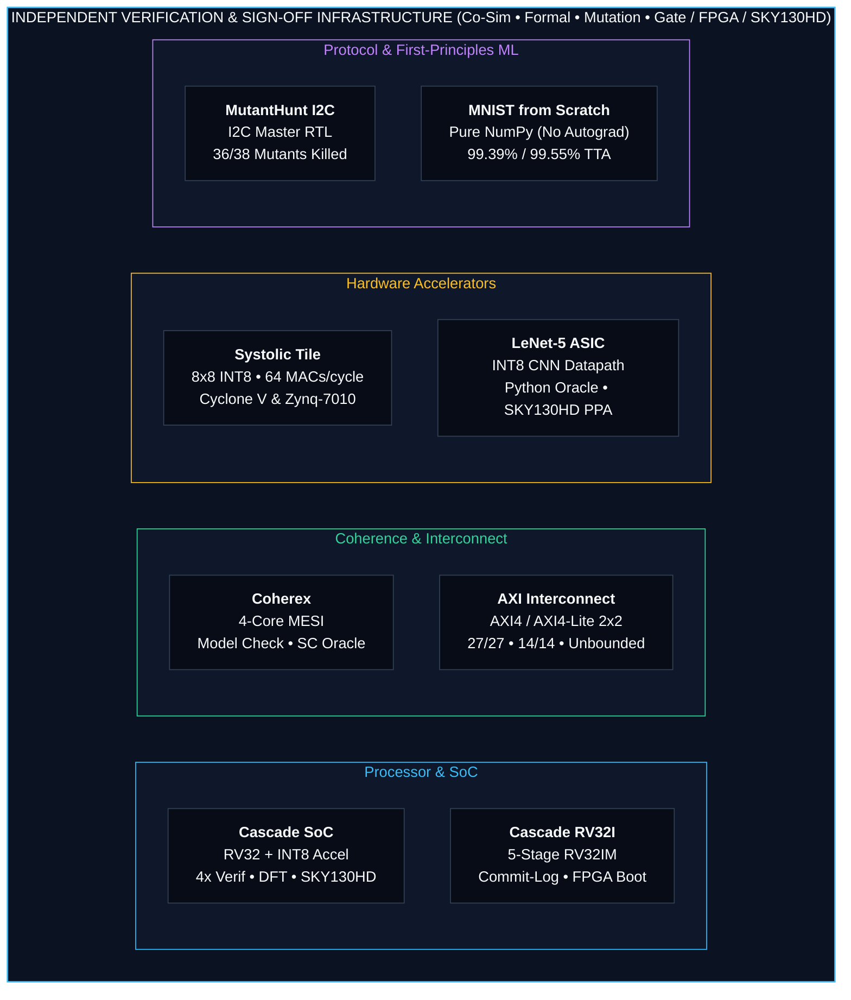
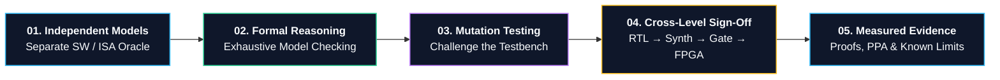

<div align="center">

<!-- Hero Silicon Wave Banner -->


<!-- Animated Terminal Subtitle -->
<a href="https://github.com/3more102">
  
</a>

<br/>

<!-- Affiliation & Profile Header Pills -->
<p align="center">
  
  <a href="https://github.com/3more102">
    
  </a>
</p>

<!-- Domain & Silicon Tooling Badges -->
<p align="center">
  
  
  
  
  
  
  
  <br/>
  
  
  
  
  
  
</p>

<!-- Quick Navigation Bar -->
<p align="center">
  <a href="#-engineering-architecture">Architecture</a> •
  <a href="#-featured-engineering-projects">Featured Projects</a> •
  <a href="#-selected-measured-results">Measured Results</a> •
  <a href="#-verification-philosophy">Philosophy</a> •
  <a href="#-current-development">Current Development</a> •
  <a href="#-engineering-telemetry">Telemetry</a>
</p>

</div>

---

I design, implement, and verify digital hardware systems, with a focus on processor architectures, SoC integration, hardware accelerators, and verification infrastructure. My work also extends into machine learning from first principles, connecting algorithm-level understanding with hardware-efficient computation.

> [!IMPORTANT]
> **Core Engineering Principle:** A design is not validated simply because it passes its tests. Its correctness must be supported by **independent, reproducible evidence**. Across my projects, I use reference-model co-simulation, formal verification, mutation testing, protocol checking, and post-synthesis regression to challenge hardware implementations and assess the strength of their verification environments.

```systemverilog
// Verification Sign-Off Invariant
property p_justified_confidence;
    @(posedge clk)
    passing_tests |-> (independent_oracle_match && formal_proven && mutation_qualified);
endproperty

assert property (p_justified_confidence)
    else $error("Verification Gap: Passing tests alone do not prove correctness.");
```

---

## ⚡ Engineering Architecture



<details>
<summary><b>🔍 Expand Technical Focus Matrix (7 Core Engineering Domains)</b></summary>
<br>

| Domain | Areas of Work |
| :--- | :--- |
| **Digital RTL Design** | RISC-V processors, pipelined datapaths, accelerators, memory interfaces |
| **Design Verification** | Golden-model comparison, constrained testing, scoreboards, mutation testing |
| **Formal Methods** | Model checking, protocol properties, exhaustive state-space exploration |
| **SoC Architecture** | Processor–accelerator integration, AXI interconnects, cache coherence |
| **ASIC Implementation** | RTL-to-GDSII workflows, SKY130HD, PPA evaluation, DFT |
| **FPGA Prototyping** | Functional validation and implementation on physical FPGA platforms |
| **Hardware-Oriented ML** | Quantized inference, systolic computation, neural networks from scratch |

</details>

---

## 🛠️ Featured Engineering Projects

### Processor Architecture & SoC Integration

<table>
<tr>
<td width="50%" valign="top">

#### 🔹 [Cascade SoC](https://github.com/3more102/cascade-soc)
 

<kbd>RISC-V SoC</kbd> <kbd>INT8 Accelerator</kbd> <kbd>SKY130HD</kbd> <kbd>DFT</kbd>

RISC-V System-on-Chip with an integrated INT8 accelerator, bringing together processor architecture, accelerator functionality, and system-level verification.
- Integration verified through **four independent approaches**
- **Design-for-test (DFT)** implementation with measured fault coverage
- **RTL-to-GDSII** implementation targeting the SKY130HD standard-cell library
- *Status: Physical implementation and place-and-route in progress*

<details>
<summary><code>View System Topology</code></summary>

```text
┌───────────────┐      ┌──────────────────────┐
│  RISC-V Core  │◀────▶│ System Interconnect  │
└───────────────┘      └──────────┬───────────┘
                                  │
                       ┌──────────▼───────────┐
                       │   INT8 Accelerator   │
                       └──────────┬───────────┘
                                  ▼
 [4 Independent Verification Approaches] + [DFT & SKY130HD PnR]
```
</details>

</td>
<td width="50%" valign="top">

#### 🔹 [Cascade RV32I](https://github.com/3more102/cascade-rv32i)
 

<kbd>RV32IM</kbd> <kbd>5-Stage Pipeline</kbd> <kbd>FPGA Booted</kbd> <kbd>Mutation Tested</kbd>

Five-stage RV32IM processor verified across RTL simulation, synthesized logic, and physical FPGA execution.
- **Five-stage pipelined** RISC-V microarchitecture
- **Architectural commit-log co-simulation** against an independent golden model
- **Gate-level regression** to assess synthesized behavior
- **Mutation testing** to evaluate verification effectiveness
- **Successfully booted** on physical FPGA hardware

<details>
<summary><code>View Cross-Level Validation Flow</code></summary>

```text
[RV32IM RTL] ──▶ Commit-Log Co-Sim ◀── [Independent Golden Model]
     │
     ├──▶ Mutation Testing (Testbench Strength Evaluation)
     ├──▶ Synthesis ──▶ Gate-Level Regression
     └──▶ Physical FPGA Bitstream ──▶ Hardware Boot Verified
```
</details>

</td>
</tr>
</table>

### Hardware Acceleration & ASIC Design

<table>
<tr>
<td width="50%" valign="top">

#### 🔹 [Systolic Tile](https://github.com/3more102/systolic-tile)
 

<kbd>8×8 INT8</kbd> <kbd>64 MACs/cycle</kbd> <kbd>Cyclone V</kbd> <kbd>Zynq-7010</kbd>

8×8 INT8 systolic-array accelerator built for deterministic arithmetic correctness and portable hardware implementation.
- **64 multiply–accumulate** operations per cycle
- **Bit-exact validation** against a Python reference model
- **FPGA builds** targeting Intel Cyclone V and AMD/Xilinx Zynq-7010

</td>
<td width="50%" valign="top">

#### 🔹 [LeNet-5 ASIC Accelerator](https://github.com/3more102/lenet5-asic-accelerator)
 

<kbd>INT8 Inference</kbd> <kbd>SKY130HD GDSII</kbd> <kbd>PPA Measured</kbd>

Hardware implementation of a quantized LeNet-5 neural-network inference datapath connecting quantized ML computation with measurable ASIC results.
- **Bit-exact comparison** against an independent Python oracle
- **Physical implementation** and measured power, performance, and area using SKY130HD

</td>
</tr>
</table>

### Formal Verification & Protocol Correctness

<table>
<tr>
<td width="50%" valign="top">

#### 🔹 [Coherex](https://github.com/3more102/Coherex)
 

<kbd>4-Core MESI</kbd> <kbd>Model Checking</kbd> <kbd>Sequential Consistency</kbd>

Four-core MESI cache-coherence system focused on coherence invariants, memory-ordering correctness, and independent checker validation.
- **RTL implementation** of a multicore coherence system
- **Exhaustive protocol model checking**
- **Independent sequential-consistency oracle**
- **Mutation-qualified checkers** for verification-quality assessment

<details>
<summary><code>View Coherence Verification Topology</code></summary>

```text
 [Core 0 L1]   [Core 1 L1]   [Core 2 L1]   [Core 3 L1]
      └─────────────┴──────┬──────┴─────────────┘
                    [MESI Coherence Fabric]
                           │
        ┌──────────────────┼──────────────────┐
        ▼                  ▼                  ▼
 [Model Checker]   [SC Memory Oracle]  [Mutation Checkers]
```
</details>

</td>
<td width="50%" valign="top">

#### 🔹 [AXI Interconnect Verification](https://github.com/3more102/axi-interconnect-verif)
 

<kbd>AXI4 / AXI4-Lite</kbd> <kbd>2×2 Crossbar</kbd> <kbd>Unbounded Formal</kbd>

AXI4 / AXI4-Lite 2×2 crossbar verified through simulation, mutation testing, and formal proof.
- **27 / 27** regression tests passing
- **14 / 14** injected mutation defects detected
- **Unbounded formal proofs** achieved for both interconnects

</td>
</tr>
</table>

### Mutation-Driven Verification & First-Principles ML

<table>
<tr>
<td width="50%" valign="top">

#### 🔹 [MutantHunt I²C](https://github.com/3more102/mutanthunt-i2c)
 

<kbd>I²C Master RTL</kbd> <kbd>Mutation Testing</kbd> <kbd>36/38 Detected</kbd>

I²C master RTL and mutation-driven verification environment measuring what a testbench can detect rather than relying on passing-test counts alone.
- **38 deliberately injected** RTL defects
- **36 defects detected** by the verification environment
- **Two surviving mutations** explicitly demonstrated and documented

</td>
<td width="50%" valign="top">

#### 🔹 [MNIST Neural Network from Scratch](https://github.com/3more102/mnist-nn-scratch)
 

<kbd>First Principles</kbd> <kbd>Pure NumPy</kbd> <kbd>No Autograd</kbd>

Neural-network implementation using NumPy without automatic differentiation, built for mathematical understanding, numerical correctness, and reproducible experimentation.
- **99.39%** MNIST classification accuracy (**99.55%** with test-time augmentation)
- **Manually implemented** backpropagation, convolution, and batch normalization
- **No autograd framework**

</td>
</tr>
</table>

---

## 📊 Selected Measured Results

| Project | Sign-Off Evidence | Verified Result |
| :--- | :--- | :--- |
| **[Cascade SoC](https://github.com/3more102/cascade-soc)** |  | Four independent integration-verification approaches; DFT fault coverage; SKY130HD PnR active |
| **[Cascade RV32I](https://github.com/3more102/cascade-rv32i)** |  | Golden-model and gate-level verification; mutation tested; physical FPGA boot |
| **[Systolic Tile](https://github.com/3more102/systolic-tile)** |  | 64 INT8 MAC operations/cycle; bit-exact reference-model comparison |
| **[LeNet-5 Accelerator](https://github.com/3more102/lenet5-asic-accelerator)** |  | Bit-exact validation; SKY130HD PPA measurements |
| **[Coherex](https://github.com/3more102/Coherex)** |  | Exhaustive protocol model checking and mutation-qualified checkers |
| **[AXI Interconnect](https://github.com/3more102/axi-interconnect-verif)** |  | 27/27 tests passing; 14/14 mutation defects detected; unbounded formal proofs |
| **[MutantHunt I²C](https://github.com/3more102/mutanthunt-i2c)** |  | 36/38 injected defects detected; two survivors documented |
| **[MNIST from Scratch](https://github.com/3more102/mnist-nn-scratch)** |  | 99.39% accuracy; 99.55% with test-time augmentation |

<sub>*Each result is specific to its project's documented implementation, configuration, and verification scope.*</sub>

---

## 🔬 Verification Philosophy

I treat verification as an engineering discipline with measurable outcomes, not simply a final stage of development. **The objective is not to maximize the number of passing tests. It is to maximize justified confidence in the design.**



- **01 — Independent Reference Models:** Compare DUT behavior against separate software or architectural models to avoid relying exclusively on implementation-derived expectations.
- **02 — Formal Reasoning:** Use formal properties and exhaustive model checking where applicable to investigate behavior beyond directed simulation scenarios.
- **03 — Verification of the Verification Environment:** Inject deliberate defects and determine whether existing checkers detect them. Surviving mutations are evidence of verification limitations that require explanation.
- **04 — Cross-Level Validation:** Where supported by the project, validate behavior across RTL simulation, synthesis, gate-level regression, and physical FPGA implementation.
- **05 — Measurable Engineering Evidence:** Report actual test results, proof status, performance measurements, implementation results, and known limitations.

---

## 🚀 Current Development

| Milestone | Target Platform | Pipeline Stage | Objective |
| :--- | :--- | :--- | :--- |
| **Cascade SoC — Silicon Implementation** | `SKY130HD` |  | Advancing the integrated RISC-V SoC through physical implementation to complete the RTL-to-GDSII flow on SKY130HD |
| **Keccak Tile — Cryptographic Hardware** | `Tiny Tapeout` |  | Progressing from a validated golden model toward synthesizable RTL, independent verification, and a physical implementation submission |

<sub>*These are ongoing engineering milestones, not completed silicon claims.*</sub>

---

## 📈 Engineering Telemetry & Interests

- **RISC-V** microarchitecture and SoC design
- **Digital ASIC** design and RTL verification
- **Formal verification** and verification-quality measurement
- **Memory systems**, interconnects, and cache coherence
- **Hardware acceleration** for machine learning and cryptography
- **DFT**, physical implementation, and silicon validation

<div align="center">
  <br/>
  <a href="https://github.com/3more102">
    
  </a>
  <br/><br/>
  <a href="https://github.com/3more102">
    
  </a>
</div>

> [!NOTE]
> **Build the design. Build an independent way to challenge it. Measure the evidence. Document the limits.**
> The repositories above reflect an effort to develop hardware systems that are not only functional, but also independently verifiable, reproducible, and supported by concrete engineering results.


